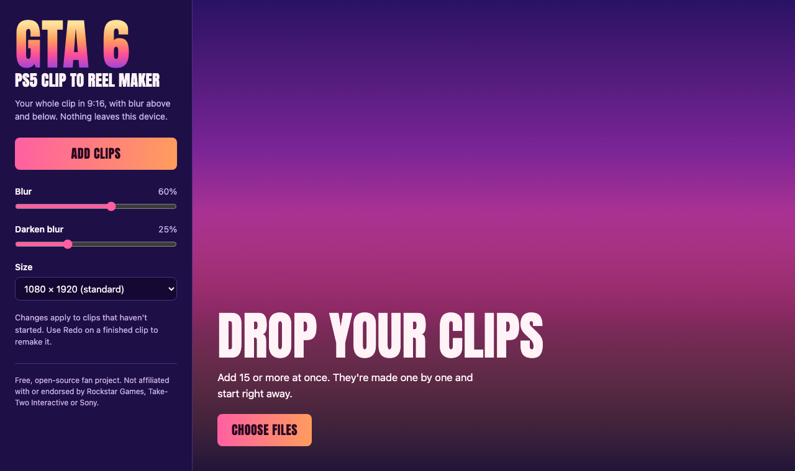

# GTA 6 PS5 Clip to Reel Maker

Turn PS5 gameplay clips into 9:16 reels for Instagram, TikTok and YouTube Shorts. Your whole clip stays in frame, with a moving blur above and below it. Nothing is cropped or cut.

Everything runs in your browser. There is no server, no upload, no account and no install.



## Use it

1. Download this repository (**Code > Download ZIP**) and unzip it.
2. Open `index.html` in Chrome, Edge or Arc.
3. Drop in your clips. Conversion starts right away, one clip at a time.
4. Download each reel, or press **Download all** to save them into one folder.

Copy clips off your PS5 with a USB drive or the PlayStation App first.

## Features

- Add 15 or more clips at once
- Full clip in the middle of a 9:16 frame, with no cropping
- Adjustable blur and darkness, with a live preview
- 1080 x 1920 or 4K (2160 x 3840) MP4 (H.264 and AAC)
- Keeps the original frame rate, including 60 fps
- AAC sound is copied without re-encoding
- Reads MP4, WebM, MOV and MKV, as long as your browser can decode the video

## Good to know

- Finished reels live in the tab until you download them. Closing the tab removes them.
- Keep the tab open and visible during long batches, since browsers can slow down background tabs.
- HDR clips come out as SDR.
- It needs a browser with WebCodecs and H.264 encoding. Development has been tested in Chromium. Safari and Firefox are untested.

## Add the official artwork (optional)

For the full look on your own computer, run this in the project folder. It needs Python 3:

```bash
python3 get-art.py
```

It downloads the logo and two wallpapers from Rockstar's own servers into the `art` folder, which git ignores. Rockstar's terms allow personal, non-commercial use only, so the artwork isn't included here. [art/README.md](art/README.md) explains how to add other images.

## How it works

Each frame is decoded with [WebCodecs](https://developer.mozilla.org/docs/Web/API/WebCodecs_API), drawn to a canvas (a blurred fill first, then the full clip), and encoded again. [Mediabunny](https://mediabunny.dev) reads and writes the video files. There is no build step.

| File | What it does |
| --- | --- |
| `index.html` | The page |
| `style.css`, `font.css` | The look, with the font embedded |
| `app.js` | Queue, drawing, conversion and saving |
| `get-art.py` | Downloads the optional artwork from Rockstar |
| `art/` | Optional artwork you add yourself, see [art/README.md](art/README.md) |
| `mediabunny.min.js` | Mediabunny 1.66.4, unmodified |

To change the defaults, edit `DEFAULTS` at the top of `app.js`.

## License

The code is under the [MIT License](LICENSE). Bundled parts keep their own licenses:

- Mediabunny: [MPL-2.0](licenses/mediabunny-MPL-2.0.txt), source at https://github.com/Vanilagy/mediabunny
- Anton font: [SIL Open Font License 1.1](licenses/Anton-OFL.txt)

## Disclaimer

This is an unofficial fan project. It is not affiliated with, endorsed by or sponsored by Rockstar Games, Take-Two Interactive or Sony Interactive Entertainment. All trademarks belong to their owners. This repository contains no game assets, logos or footage.
